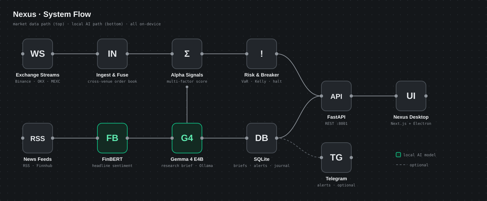

# Nexus · System Flow

**Market path:** exchange streams (Binance, OKX, MEXC) → ingest and fuse into one order book → alpha signals → risk checks and circuit breaker → FastAPI → desktop app.

**AI path:** news feeds → FinBERT scores sentiment → Gemma 4 E4B writes the research brief from that sentiment and the alpha signals → SQLite → FastAPI → desktop app. Telegram alerts are optional.

Everything runs on your machine: the AI models run locally through Ollama and Hugging Face, and market data comes from public streams, so no API keys are required.
